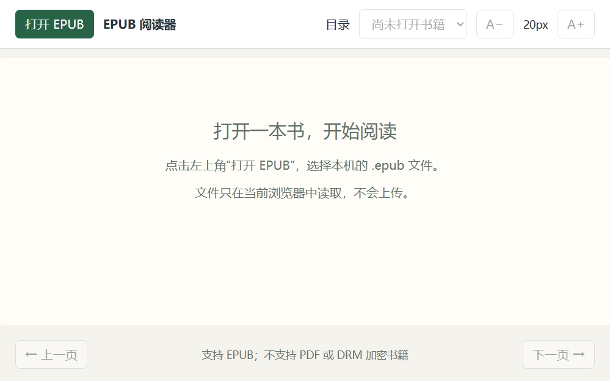

# 简单 EPUB 阅读器

下载了一个 EPUB 阅读器，居然有广告。于是让 GPT one shot 了一个纯本地的版本。支持翻页、章节目录、字号调整和封面等比显示，只需要 **Node.js 22+ 和浏览器**。

## 效果预览

**打开页面**



**阅读效果**


截图使用原创演示文字，不含第三方书籍正文。

## 快速开始

下载仓库 ZIP 并解压，双击 **start.cmd** 即可启动；也可以克隆后运行：

```powershell
git clone git@github.com:chench53/epub-reader.git
Set-Location '.\epub-reader'
node start.cjs
```

浏览器会自动打开 <http://127.0.0.1:8000/>。仓库已包含离线阅读组件，**无需 `npm install`**，也可用 `npm start` 启动。使用时保留命令行窗口，退出时按 **Ctrl+C**。

## 阅读

- **打开 EPUB**：选择本机文件，再次点击可切换书籍。
- **上一页 / 下一页** 或 **← / →**：翻页；焦点在目录等控件上时，方向键保留控件本身的操作。
- **目录**：跳转章节。
- **A− / A+**：调整字号（14–32px）。

### 注意事项

- 支持离线使用，仅监听本机地址；不启用书籍脚本、外部联网资源或外部链接。
- 不保存阅读进度，刷新或关闭后需重新选择文件。
- 不支持 PDF 和 DRM 加密书籍；部分格式异常的书籍可能出现样式提示。
- 请通过启动器访问，不要直接双击网页文件。

端口被占用或不想自动打开浏览器时：

```powershell
node start.cjs --port 8001 --no-browser
```

## 开发

```powershell
npm ci
npm run build
npm test
```

`npm run build` 将阅读组件及许可证复制到 `web\vendor`；组件丢失时也可用上述命令恢复。

## 许可证

本项目代码采用 [MIT 许可证](LICENSE)。

随仓库提供的第三方组件保留其各自许可证：

- epub.js：BSD-2-Clause，见 [epubjs-LICENSE](web/vendor/epubjs-LICENSE)。
- JSZip：MIT 或 GPL-3.0 双许可证，本项目按 MIT 条款使用，见 [JSZip-LICENSE.markdown](web/vendor/JSZip-LICENSE.markdown)。

仓库不包含电子书；请自行选择有权阅读的 EPUB 文件。
